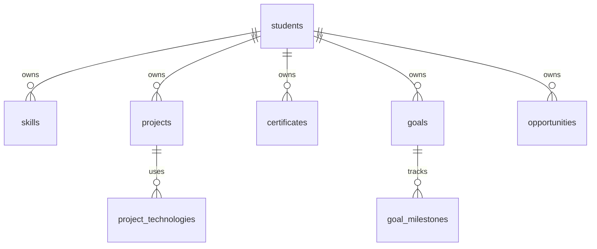

# SkillOrbit

SkillOrbit is a student skill and opportunity tracker built as a React + Vite frontend, an Express API, and PostgreSQL persistence. The initial dataset and profile are synthetic and intended for a college demonstration.

## Features

- Dashboard counts, learning progress, upcoming deadlines, and recent activity from PostgreSQL.
- Searchable skills, projects, certificates, learning goals, and opportunities with create, edit, and delete workflows.
- Opportunity status filtering and updates: Saved, Applied, Interviewed, Completed, and Rejected.
- Portfolio preview generated from the saved student profile, skills, projects, and certificates, with print and share-summary actions.
- Loading, empty, validation, connection-error, and success feedback; responsive layout and keyboard focus styles.

## Architecture



The demo currently uses one fixed synthetic student ID. All module queries are scoped to that ID. This is not a multi-user authentication or authorization system.

## Prerequisites

- Node.js 20.19+ or 22.12+ (required by the installed Vite release)
- npm
- PostgreSQL, such as the existing Neon database, or a local PostgreSQL server

## Local setup

In PowerShell, from `C:\skillorbit`:

```powershell
Copy-Item .\server\.env.example .\server\.env
notepad .\server\.env
```

Set `DATABASE_URL` to your private PostgreSQL connection string. Keep it only in `server/.env`. For Neon use `DATABASE_SSL=true`; for local PostgreSQL use `DATABASE_SSL=false`. The sample contains no real credentials.

Install dependencies:

```powershell
cd C:\skillorbit\server
npm ci
cd ..\client
npm ci
```

Initialize or update the schema and insert the synthetic demo records:

```powershell
cd C:\skillorbit\server
npm run db:migrate
npm run db:seed
```

The migration is versioned, transactional, and safe to rerun. The seed uses a marker, so restarting the app does not recreate demo data that was intentionally deleted.

Start the backend and frontend in separate PowerShell terminals:

```powershell
# Terminal 1
cd C:\skillorbit\server
npm run dev
```

```powershell
# Terminal 2
cd C:\skillorbit\client
npm run dev
```

Open `http://localhost:5173`. The API health endpoint is `http://localhost:4000/api/health`. Vite proxies `/api` to the local API when `VITE_API_URL` is blank. To override locally, copy `client/.env.example` to `client/.env` and leave `VITE_API_URL=` blank.

## Environment variables

| Variable | Where it belongs | Purpose |
| --- | --- | --- |
| `DATABASE_URL` | `server/.env`; Render service | Private PostgreSQL URL. Never add it to a `VITE_*` variable. |
| `DATABASE_SSL` | `server/.env`; Render service | Set `true` for Neon TLS; `false` for local PostgreSQL. |
| `CORS_ORIGIN` | `server/.env`; Render service | Comma-separated frontend origins, without trailing slashes. |
| `PORT` | `server/.env` for local use | Local API port, default `4000`. Render supplies its own port. |
| `VITE_API_URL` | `client/.env` for optional local override; Vercel project | Public API origin only, with no `/api` suffix. Leave blank for local Vite proxying. |

The root `.env.example`, `client/.env.example`, and `server/.env.example` contain variable names and safe blank placeholders only. Actual `.env` files are ignored by Git.

## Tests and build

From `server/`:

```powershell
npm test
npm run test:integration
```

The integration tests use `server/.env` when present and exercise the configured PostgreSQL database. They create and delete temporary test records.

From `client/`:

```powershell
npm run lint
npm run build
```

## Deployment preparation

No service has been deployed or created. These are the project settings to enter after you approve deployment and have the public origins:

### Neon

Use the existing PostgreSQL database. Copy its private connection string into the Render service's `DATABASE_URL` setting, enable `DATABASE_SSL=true`, and keep the URL out of the frontend and repository. The API runs pending migrations and seeds the synthetic demo on startup; the explicit database commands remain available for local setup.

### Render API

- Root directory: `server`
- Runtime: Node.js
- Build command: `npm ci`
- Start command: `npm start`
- Health check path: `/api/health`
- Set `DATABASE_URL`, `DATABASE_SSL=true`, and `CORS_ORIGIN` to the final Vercel site origin. Render supplies `PORT`.

### Vercel frontend

- Root directory: `client`
- Framework preset: Vite
- Build command: `npm run build`
- Output directory: `dist`
- Set `VITE_API_URL` to the Render API origin, such as `https://<your-api>.onrender.com`, without `/api`.

The navigation is state-based and does not add browser routes, so no SPA rewrite is currently needed. A public frontend URL must exist before configuring `CORS_ORIGIN`; a Render API URL must exist before setting `VITE_API_URL`. Platform free-tier behavior and current deployment limits have not been researched and should be checked separately before choosing a plan.

## GitHub publication checklist

- `.gitignore` excludes `.env` files, dependencies, build output, logs, and editor-specific files; `.env.example` files are allowed.
- Do not commit `server/.env`, `client/.env`, or any database credentials.
- The current local repository has no commits yet. Review the working tree and create the initial commit only when you are ready; this project has not been pushed or published.

## Limitations

- One synthetic student only; there is no authentication, user management, or real student-data isolation.
- No live job scraping, public portfolio URL, or deployed cloud service.
- Database downtime makes data routes return HTTP 503. The health endpoint remains available and reports the database state.
- Tests cover API health, CRUD persistence, validation, status transitions, and dashboard calculations. No browser automation or accessibility audit is configured yet.
